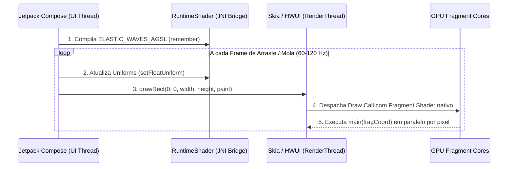

# ⚡ 3. Pipeline GPU no Android: AGSL & `RuntimeShader`

Para avaliar a equação da membrana em cada pixel da tela a 60 ou 120 quadros por segundo sem sobrecarregar a CPU, o **Membrana** utiliza o **AGSL (Android Graphics Shading Language)** acoplado à API nativa `android.graphics.RuntimeShader`, introduzida no **Android 13 (API 33 / Tiramisu)**.

---

## 1. O que é o AGSL e como ele funciona no Android?

O **AGSL** é a linguagem de sombreamento de fragmentos de alto nível do sistema de View/Canvas do Android, derivada diretamente do **SkSL (Skia Shading Language)** e sintaticamente baseada no padrão **GLSL ES 1.0**.

Ao contrário de um pipeline OpenGL ES ou Vulkan tradicional — onde seria necessário criar um `GLSurfaceView`/`TextureView`, gerenciar contextos EGL, buffers de vértices (VBOs) e *framebuffers* separados da árvore do Jetpack Compose —, o `RuntimeShader` integra-se nativamente ao **HWUI (Hardware UI RenderThread)** do Android:



### Principais Diferenças entre AGSL e GLSL Tradicional

| Característica | GLSL Padrão (OpenGL ES) | AGSL (`RuntimeShader`) |
| :--- | :--- | :--- |
| **Ponto de Entrada** | `void main()` escrevendo em `gl_FragColor` | `half4 main(float2 fragCoord)` retornando a cor diretamente |
| **Sistema de Coordenadas** | Origem no canto **inferior esquerdo** $(0,0)$ | Origem no canto **superior esquerdo** $(0,0)$, idêntica ao `Canvas` do Compose |
| **Espaço de Cor Alpha** | *Straight Alpha* (não pré-multiplicado por padrão) | **Premultiplied Alpha** obrigatório (`color * aa`) |
| **Precisão de Tipos** | `float`, `vec2`, `vec4` | `float`/`float2`/`float4` (32 bits, ideal para geometria/SDF) e `half`/`half4` (16 bits FP16, ideal para cores RGBA) |

---

## 2. Alocação e Memoização na Árvore Compose

Compilar o código-fonte de um shader (`RuntimeShader(ELASTIC_WAVES_AGSL)`) envolve análise léxica, validação de tipos e geração de bytecode intermediário pelo motor Skia. Executar isso a cada quadro causaria *jank* severo.

Em [`ElasticWavesShaderBox.kt`](https://github.com/filipecancio/membrana/blob/main/app/src/main/java/com/cancio/membrana/ui/components/ElasticWavesShaderBox.kt#L123-L138), garantimos que a compilação do shader e a criação do `android.graphics.Paint` ocorram **uma única vez** na entrada do componente na composição via `remember`:

```kotlin
val isAgslSupported = Build.VERSION.SDK_INT >= Build.VERSION_CODES.TIRAMISU

val runtimeShader = remember(isAgslSupported) {
    if (isAgslSupported) {
        RuntimeShader(ELASTIC_WAVES_AGSL)
    } else null
}

val paint = remember(runtimeShader) {
    if (runtimeShader != null && isAgslSupported) {
        android.graphics.Paint().apply {
            shader = runtimeShader
            isAntiAlias = true
        }
    } else null
}
```

---

## 3. Independência de Densidade (`Dp` $\to$ `Px`)

Os shaders na GPU operam estritamente no espaço físico do *framebuffer* (**pixels**), enquanto o layout e os controles da interface do Android operam em **Density-independent Pixels (`dp`)**.

Se passássemos valores brutos de `dp` para o shader, a membrana pareceria 3.5 vezes menor em uma tela QHD (`xxxhdpi`) do que em uma tela `mdpi`. Por isso, convertemos todas as grandezas espaciais usando o `LocalDensity.current` antes de enviá-las para os *uniforms*:

```kotlin
val density = LocalDensity.current

val boxWidthPx        = with(density) { boxWidth.toPx() }
val boxHeightPx       = with(density) { boxHeight.toPx() }
val boxCornerRadiusPx = with(density) { boxCornerRadius.toPx() }
val ballRadiusPx      = with(density) { ballRadius.toPx() }
val elasticTensionPx  = with(density) { elasticTension.dp.toPx() }
```

Assim, uma tensão de membrana calibrada em $48\text{ dp}$ terá exatamente a mesma proporção física em milímetros em qualquer smartphone ou tablet.

---

## 4. Sincronização de Uniforms (CPU $\to$ GPU)

Dentro do bloco `Canvas(modifier = Modifier.fillMaxSize())`, atualizamos os registradores *uniform* do `RuntimeShader` imediatamente antes da chamada de desenho:

| Uniform AGSL | Tipo | Valor Enviado pela CPU | Papel no Shader |
| :--- | :--- | :--- | :--- |
| `uResolution` | `float2` | `(size.width, size.height)` | Dimensões totais da área de desenho em pixels |
| `uBoxCenter` | `float2` | `(size.width / 2f, size.height / 2f)` | Coordenada central da pílula estática |
| `uBoxSize` | `float2` | `(boxWidthPx / 2f, boxHeightPx / 2f)` | Meia-largura e meia-altura (*half-extents* $\mathbf{b}$) exigidas por `sdRoundBox` |
| `uBoxRadius` | `float` | `boxCornerRadiusPx` | Raio de arredondamento dos cantos da caixa ($r$) |
| `uBallCenter` | `float2` | `(center.x + ballX.value, center.y + ballY.value)` | Posição instantânea da bola invasora (arraste ou mola) |
| `uBallRadius` | `float` | `ballRadiusPx` | Raio da bola invasora controlado pelo slider |
| `uBlendK` | `float` | `elasticTensionPx` | Parâmetro $k$ do `smin` (tensão elástica da membrana) |
| `uBoxColor` | `half4` | `(red, green, blue, alpha)` em $[0, 1]$ | Cor base da pílula central (`Color.White`) |
| `uBallColor` | `half4` | `(red, green, blue, alpha)` em $[0, 1]$ | Cor base da esfera invasora (`#E53935`) |

### Por que usamos `setFloatUniform` para Cores (`half4`)?

Embora `RuntimeShader` possua o método `setColorUniform`, o uso explícito de `setFloatUniform("uBoxColor", color.red, color.green, color.blue, color.alpha)` garante que os quatro canais normalizados $[0.0, 1.0]$ sejam alimentados diretamente no registrador `half4` sem conversões implícitas de espaço de cor (`ColorSpace`) que podem variar entre fabricantes de GPU (Adreno, Mali, PowerVR).

### Execução no `nativeCanvas`

```kotlin
drawIntoCanvas { canvas ->
    canvas.nativeCanvas.drawRect(
        0f, 0f, size.width, size.height, paint
    )
}
```

Ao desenhar um retângulo cobrindo `0f, 0f, size.width, size.height` com o `paint` vinculado ao `runtimeShader`, instruímos a GPU a executar a função `main(fragCoord)` para cada pixel visível do container.

---

## 5. Estratégia de Fallback Vetorial (Android 7.0 a 12 / APIs 24–32)

O `minSdk` do aplicativo é **24 (Android 7.0 Nougat)**, enquanto o `RuntimeShader` requer **API 33 (Android 13)**. Para garantir que o app execute sem falhas em dispositivos anteriores ao Android 13, implementamos um fallback geométrico direto no `Canvas` do Compose:

```kotlin
} else {
    drawRoundRect(
        color = boxColor,
        topLeft = Offset(center.x - boxWidthPx / 2f, center.y - boxHeightPx / 2f),
        size = Size(boxWidthPx, boxHeightPx),
        cornerRadius = CornerRadius(boxCornerRadiusPx)
    )
    drawCircle(
        color = ballColor,
        radius = ballRadiusPx,
        center = currentBallCenter
    )
}
```

Em dispositivos API 24–32, a interação 360° e a física de mola continuam funcionando integralmente, renderizando as primitivas vetoriais aceleradas por hardware.

---

## Próximo Passo

Veja na última página como o arraste multiaxial em 360° e a física de mola (`Spring`) governam o movimento da bola invasora sem causar recomposições desnecessárias na árvore de UI:
👉 **[🎢 4. Interação 360°, Gestos e Física de Mola (`Spring`)](Fisica-de-Mola-e-Gestos-Compose)**
