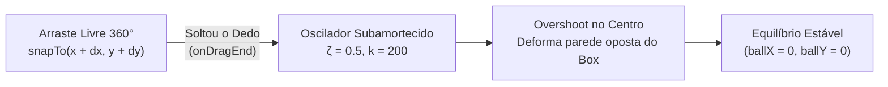

# 🎢 4. Interação 360°, Gestos e Física de Mola (`Spring`)

Para que a deformação da membrana AGSL pareça tátil e viva, a esfera invasora precisa responder instantaneamente ao toque em qualquer direção (360°) e retornar ao centro de equilíbrio com a dinâmica real de um corpo elástico preso a uma mola quando o usuário solta o dedo.

---

## 1. Representação Vetorial 2D com `Animatable`

Em [`ElasticWavesShaderBox.kt`](https://github.com/filipecancio/membrana/blob/main/app/src/main/java/com/cancio/membrana/ui/components/ElasticWavesShaderBox.kt#L114-L115), o deslocamento da esfera em relação ao centro da pílula $\mathbf{c} = (\text{width}/2, \text{height}/2)$ é modelado por dois canais contínuos independentes do tipo `Animatable<Float, AnimationVector1D>`:

```kotlin
val ballX = remember { Animatable(0f) }
val ballY = remember { Animatable(0f) }
```

* $(0, 0)$ representa o estado de **repouso absoluto**, onde o centro da esfera coincide com o centro da caixa (`uBallCenter == uBoxCenter`).
* Durante o arraste ou durante a oscilação da mola, a posição real da esfera no `Canvas` é dada pela soma vetorial:

$$
\mathbf{p}_{\text{ball}}(t) = \mathbf{c}_{\text{box}} + \begin{bmatrix} \text{ballX}(t) \\ \text{ballY}(t) \end{bmatrix}
$$

---

## 2. Captura de Gestos Multiaxiais (`detectDragGestures`)

O modificador `pointerInput(Unit)` intercepta os eventos de toque na área da tela através do detector `detectDragGestures`:

```kotlin
onDrag = { change, dragAmount ->
    change.consume()
    scope.launch {
        ballX.snapTo(ballX.value + dragAmount.x)
        ballY.snapTo(ballY.value + dragAmount.y)
        onBallPositionChanged(Offset(ballX.value, ballY.value))
    }
}
```

### Por que usamos `snapTo` durante o `onDrag`?

Enquanto o dedo do usuário está em contato com o vidro, não deve haver atraso de interpolação (*lag* elástico) entre o dedo e a bola:
1. `change.consume()` marca o evento de ponteiro como consumido no sistema de gestos do Compose.
2. `dragAmount` fornece o vetor diferencial $(\Delta x, \Delta y)$ desde a última amostra do digitalizador de toque (tipicamente a 120 Hz ou 240 Hz).
3. `snapTo` atualiza imediatamente o valor interno do `Animatable` (interrompendo qualquer animação de mola anterior caso o usuário "agarre" a bola no meio do voo!).

---

## 3. A Matemática da Física de Mola no `onDragEnd`

Quando o usuário solta o dedo da tela (`onDragEnd`), disparamos duas animações de mola simultâneas de volta à origem $(0, 0)$:

```kotlin
onDragEnd = {
    // Soltou: snapback elástico com mola para o centro
    scope.launch {
        launch {
            ballX.animateTo(
                targetValue = 0f,
                animationSpec = spring(
                    dampingRatio = Spring.DampingRatioMediumBouncy,
                    stiffness = Spring.StiffnessLow
                )
            )
        }
        launch {
            ballY.animateTo(
                targetValue = 0f,
                animationSpec = spring(
                    dampingRatio = Spring.DampingRatioMediumBouncy,
                    stiffness = Spring.StiffnessLow
                )
            )
        }
    }
}
```

### Equação Diferencial do Oscilador Harmônico Amortecido

Internamente, o `spring()` do Jetpack Compose resolve analiticamente a equação diferencial de segunda ordem da Lei de Hooke com amortecimento viscoso para cada eixo $u \in \{x, y\}$:

$$
m \frac{d^2 u}{dt^2} + c \frac{du}{dt} + k_{\text{mola}} \, u(t) = 0
$$

Para massa unitária ($m = 1$), a equação é parametrizada pela **rigidez** ($k_{\text{mola}} = \text{stiffness} = \omega_n^2$) e pela **razão de amortecimento** ($\zeta = \text{dampingRatio}$):

$$
\frac{d^2 u}{dt^2} + 2 \zeta \omega_n \frac{du}{dt} + \omega_n^2 u(t) = 0
$$

No **Membrana**, escolhemos os seguintes parâmetros físicos:
* **`dampingRatio = Spring.DampingRatioMediumBouncy` ($\zeta = 0.5$)**:
  Como $0 < \zeta < 1$, o sistema opera em **regime subamortecido** (*underdamped*). A solução analítica é uma exponencial decrescente modulada por uma senoide de frequência amortecida $\omega_d = \omega_n \sqrt{1 - \zeta^2}$:
  $$
  u(t) = e^{-\zeta \omega_n t} \Big( A \cos(\omega_d t) + B \sin(\omega_d t) \Big)
  $$
  Isso significa que a bola **ultrapassa o centro da pílula** (*overshoot*) ao retornar, deformando a membrana na parede oposta antes de estabilizar em $(0, 0)$!
* **`stiffness = Spring.StiffnessLow` ($k_{\text{mola}} = 200.0$)** :
  Uma constante de rigidez baixa reduz a frequência natural $\omega_n = \sqrt{200} \approx 14.14\text{ rad/s}$, tornando o retorno mais cadenciado e permitindo observar claramente as ondas de fusão e compressão do shader AGSL quando a bola reentra na pílula.



### Por que duas corrotinas `launch` aninhadas são fundamentais?

Se escrevêssemos `ballX.animateTo(0f)` seguido sequencialmente de `ballY.animateTo(0f)` na mesma corrotina, a bola primeiro se moveria horizontalmente em linha reta até $x = 0$ e só depois verticalmente até $y = 0$ (movimento em "L").

Ao lançar duas corrotinas filhas paralelas (`launch { ballX.animateTo(...) }` e `launch { ballY.animateTo(...) }`) com exatamente o mesmo `SpringSpec`, pela linearidade da equação diferencial, a combinação linear das duas soluções unidimensionais:

$$
\mathbf{u}(t) = \begin{bmatrix} x(t) \\ y(t) \end{bmatrix} = e^{-\zeta \omega_n t} \cos(\omega_d t + \phi) \begin{bmatrix} x_0 \\ y_0 \end{bmatrix}
$$

garante uma **trajetória radial retilínea perfeita em qualquer ângulo de 360°** diretamente na direção do centro da caixa!

---

## 4. Performance: Desenho Direto sem Recomposição de Layout

O pipeline de renderização do Jetpack Compose é dividido em 3 fases por frame:
1. **Composition** (Quais elementos mostrar)
2. **Layout** (Medição e posicionamento dos elementos)
3. **Drawing** (Pintura no Canvas / GPU)

Em [`ElasticWavesShaderBox.kt`](https://github.com/filipecancio/membrana/blob/main/app/src/main/java/com/cancio/membrana/ui/components/ElasticWavesShaderBox.kt#L183-L185), os estados `ballX.value` e `ballY.value` **nunca são lidos no escopo `@Composable` da função**, mas sim **exclusivamente dentro do lambda `DrawScope` do `Canvas`**:

```kotlin
Canvas(modifier = Modifier.fillMaxSize()) {
    val center = Offset(size.width / 2f, size.height / 2f)
    // Leitura do State restrita à Fase 3 (Draw)!
    val currentBallCenter = Offset(center.x + ballX.value, center.y + ballY.value)
    ...
}
```

Isso faz com que o Jetpack Compose pule completamente as fases de **Composition** e **Layout** durante todo o arraste e durante a animação da mola, invalidando apenas a fase de **Draw** e mantendo a execução cravada na taxa máxima de atualização do display (60 Hz / 90 Hz / 120 Hz).
