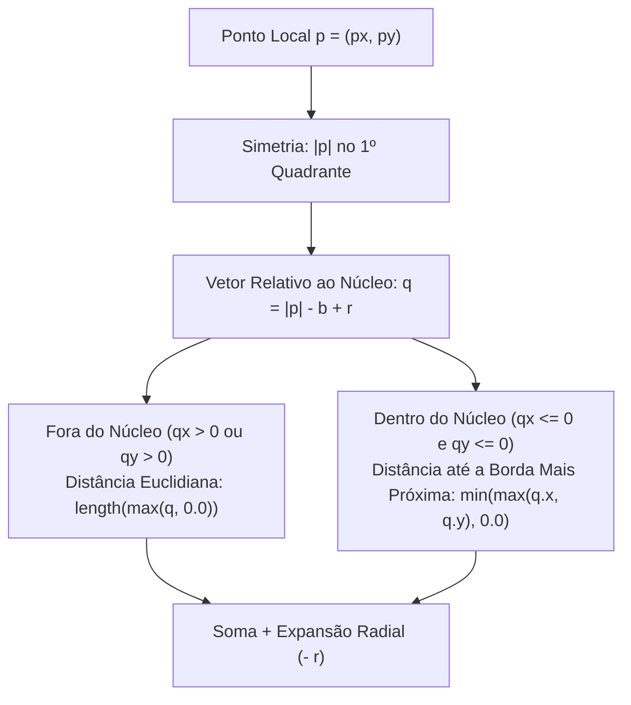

# 📐 1. Fundamentos Matemáticos: Signed Distance Fields (SDF)

No coração do **Membrana** está a substituição da geometria explícita tradicional (malhas de vértices, polígonos ou curvas de Bézier) por **superfícies implícitas** definidas através de **Signed Distance Functions (Funções de Distância com Sinal — SDF)**.

---

## 1. O que é um Signed Distance Field?

Seja $\Omega \subset \mathbb{R}^2$ uma região fechada no plano bidimensional da tela (por exemplo, o interior de um botão ou de uma esfera) com fronteira $\partial\Omega$. Uma **Signed Distance Function** $f: \mathbb{R}^2 \to \mathbb{R}$ associa a cada coordenada de pixel $\mathbf{p} = (x, y) \in \mathbb{R}^2$ a distância ortogonal mínima até a borda $\partial\Omega$, atribuindo sinal negativo aos pontos internos e positivo aos pontos externos:

$$
f(\mathbf{p}) = \begin{cases} 
-\inf_{\mathbf{q} \in \partial\Omega} \|\mathbf{p} - \mathbf{q}\|_2 & \text{se } \mathbf{p} \in \text{int}(\Omega) \quad (\text{Interior da forma}) \\[6pt]
0 & \text{se } \mathbf{p} \in \partial\Omega \quad (\text{Exatamente na borda}) \\[6pt]
+\inf_{\mathbf{q} \in \partial\Omega} \|\mathbf{p} - \mathbf{q}\|_2 & \text{se } \mathbf{p} \notin \Omega \quad (\text{Exterior da forma})
\end{cases}
$$

Onde $\|\mathbf{v}\|_2 = \sqrt{v_x^2 + v_y^2}$ denota a norma euclidiana padrão em $\mathbb{R}^2$.

### A Propriedade Eikonal

Uma SDF exata satisfaz a **Equação Eikonal** em quase todo o domínio:

$$
\|\nabla f(\mathbf{p})\|_2 = \sqrt{\left(\frac{\partial f}{\partial x}\right)^2 + \left(\frac{\partial f}{\partial y}\right)^2} = 1
$$

**Por que isso importa no código?**
1. **Unidade de Medida Direta em Pixels**: Como o gradiente tem módulo unitário ($1$), o valor retornado por $f(\mathbf{p})$ corresponde **exatamente ao número de pixels** que separam o fragmento atual da superfície da forma.
2. **Anti-Aliasing Analítico em 1 Linha**: Sabemos se o pixel está a $0.5\text{ px}$ para dentro ou para fora da borda sem precisar de *multisampling* (MSAA) caro.
3. **Isocurvas Uniformes**: Somar ou subtrair uma constante $r$ de uma SDF exata ($f(\mathbf{p}) - r$) expande ou contrai a forma perfeitamente em todas as direções (operação de *offsetting* ou *rounding* exato).

---

## 2. Translação para o Referencial Local

No fragment shader AGSL, a GPU invoca `main(float2 fragCoord)` para cada pixel da área do `Canvas`, passando a coordenada absoluta `fragCoord` medida em pixels a partir do canto superior esquerdo $(0, 0)$.

Antes de avaliar qualquer primitiva centrada em $\mathbf{c} = (c_x, c_y)$, transladamos o ponto de amostragem para a origem local da forma:

$$
\mathbf{p}_{\text{local}} = \text{fragCoord} - \mathbf{c}
$$

No código AGSL de [`ElasticWavesShaderBox.kt`](https://github.com/filipecancio/membrana/blob/main/app/src/main/java/com/cancio/membrana/ui/components/ElasticWavesShaderBox.kt#L69-L73):

```glsl
// Distância até o box centrado em uBoxCenter
float dBox = sdRoundBox(fragCoord - uBoxCenter, uBoxSize, uBoxRadius);

// Distância até o círculo centrado em uBallCenter
float dBall = sdCircle(fragCoord - uBallCenter, uBallRadius);
```

---

## 3. Dedução Matemática da Esfera (`sdCircle`)

Para um círculo centrado na origem de raio $r > 0$, a distância de qualquer ponto $\mathbf{p} = (p_x, p_y)$ até a circunferência é a diferença entre a distância do ponto à origem e o próprio raio $r$:

$$
d_{\text{circle}}(\mathbf{p}, r) = \|\mathbf{p}\|_2 - r = \sqrt{p_x^2 + p_y^2} - r
$$

* Se $\|\mathbf{p}\|_2 < r \implies d_{\text{circle}} < 0$ (dentro da bola invasora).
* Se $\|\mathbf{p}\|_2 = r \implies d_{\text{circle}} = 0$ (exatamente no perímetro).
* Se $\|\mathbf{p}\|_2 > r \implies d_{\text{circle}} > 0$ (fora da bola invasora).

### Implementação AGSL

```glsl
// Signed Distance Function para uma esfera/círculo 2D
float sdCircle(float2 p, float r) {
    return length(p) - r;
}
```

A função intrínseca `length(p)` é compilada diretamente para instruções vetoriais rápidas na ALU da GPU ($\sqrt{\mathbf{p} \cdot \mathbf{p}}$).

---

## 4. Dedução Matemática da Caixa Arredondada (`sdRoundBox`)

A caixa com cantos arredondados (ou pílula, quando $r = \text{altura}/2$) é a primitiva central que representa a membrana em repouso. Sua implementação no shader é:

```glsl
// Signed Distance Function para uma caixa com cantos arredondados
// p: coordenada local (fragCoord - uBoxCenter)
// b: meia-largura e meia-altura (width/2, height/2)
// r: raio de arredondamento dos cantos
float sdRoundBox(float2 p, float2 b, float r) {
    float2 q = abs(p) - b + r;
    return min(max(q.x, q.y), 0.0) + length(max(q, 0.0)) - r;
}
```

Embora tenha apenas duas linhas de código, essa fórmula (popularizada por *Inigo Quilez*) condensa quatro etapas geométricas elegantes:

### Passo 4.1: Simetria Axial de Quadrantes (`abs(p)`)

Um retângulo alinhado aos eixos e centrado na origem possui simetria espelhada tanto no eixo $X$ quanto no eixo $Y$. Aplicando o valor absoluto componente a componente:

$$
|\mathbf{p}| = (|p_x|, |p_y|)
$$

Rebatemos qualquer ponto dos 4 quadrantes para o **Primeiro Quadrante** ($x \ge 0, y \ge 0$). Assim, basta calcular a distância até o canto superior-direito da caixa!

### Passo 4.2: Contração pelo Raio de Canto (`b - r`)

Uma caixa de meia-dimensão $\mathbf{b} = (b_x, b_y)$ com cantos arredondados de raio $r$ é geometricamente idêntica à **soma de Minkowski** (ou expansão por isocurva $r$) de um retângulo interno menor de meia-dimensão:

$$
\mathbf{b}_{\text{interno}} = \mathbf{b} - (r, r)
$$

Definimos então o **vetor de excesso** $\mathbf{q}$ em relação ao canto desse retângulo interno:

$$
\mathbf{q} = |\mathbf{p}| - (\mathbf{b} - r) = |\mathbf{p}| - \mathbf{b} + r
$$



### Passo 4.3: Decomposição Interior vs. Exterior do Núcleo Retangular

Analisando os sinais de $q_x$ e $q_y$:

1. **Quando o ponto está FORA do retângulo interno** ($q_x > 0$ ou $q_y > 0$):
   - O termo $\min(\max(q_x, q_y), 0.0)$ zera ($= 0$).
   - O termo `length(max(q, 0.0))` calcula a distância euclidiana exata até a aresta ou até o vértice do núcleo interno:
     - Se $q_x > 0$ e $q_y \le 0$ (região lateral direita): $\sqrt{q_x^2 + 0^2} = q_x$.
     - Se $q_x \le 0$ e $q_y > 0$ (região superior): $\sqrt{0^2 + q_y^2} = q_y$.
     - Se $q_x > 0$ e $q_y > 0$ (região diagonal do canto): $\sqrt{q_x^2 + q_y^2}$ (arco circular perfeito!).

2. **Quando o ponto está DENTRO do retângulo interno** ($q_x \le 0$ e $q_y \le 0$):
   - O termo `length(max(q, 0.0))` zera ($= 0$), evitando operações de raiz quadrada desnecessárias.
   - Como tanto $q_x$ quanto $q_y$ são negativos, a distância até a parede mais próxima é o **maior** (menos negativo) entre os dois: $\max(q_x, q_y) \le 0$, preservado por $\min(\max(q_x, q_y), 0.0)$.

### Passo 4.4: Expansão pelo Raio de Canto (`- r`)

Por fim, subtraímos $r$ da distância ao retângulo interno:

$$
d_{\text{roundBox}}(\mathbf{p}, \mathbf{b}, r) = \underbrace{\min(\max(q_x, q_y), 0)}_{\text{Distância Interna}} + \underbrace{\|\max(\mathbf{q}, \mathbf{0})\|_2}_{\text{Distância Externa}} - r
$$

No **Membrana**, configuramos `boxCornerRadius = (freeBoxHeightDp / 2f).dp` ($r = 35\text{ dp}$ para altura $70\text{ dp}$), transformando o `sdRoundBox` em uma cápsula/pílula contínua com curvatura $G^1$ suave nas extremidades.

---

## Próximo Passo

Agora que temos as duas distâncias exatas `dBox` e `dBall` em cada pixel da tela, veja na próxima página como o operador **`smin` (Smooth Minimum)** funde os dois campos escalares para criar a membrana líquida:
👉 **[🧪 2. Fusão Líquida e Tensão de Membrana: Smooth Minimum (`smin`)](Fusao-Liquida-Smooth-Minimum)**
