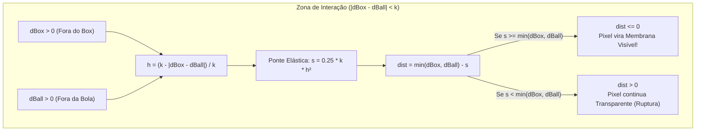

# 🧪 2. Fusão Líquida e Tensão de Membrana: Smooth Minimum (`smin`)

Uma vez que cada fragmento da GPU conhece sua distância exata até a caixa (`dBox`) e até a esfera (`dBall`), surge o desafio central do **Membrana**: como combinar essas duas formas de modo que elas se comportem como um único fluido elástico sob tensão superficial?

---

## 1. O Limite da União Booleana Clássica ($\min$)

Na Geometria Sólida Construtiva (CSG) tradicional, a união de dois campos de distância $a = d_{\text{box}}(\mathbf{p})$ e $b = d_{\text{ball}}(\mathbf{p})$ é dada pelo operador mínimo pontual:

$$
d_{\text{união}}(a, b) = \min(a, b)
$$

Embora matematicamente simples, a função $\min(a, b)$ possui uma **descontinuidade na primeira derivada** ($\nabla d$ descontínuo) ao longo de todo o lugar geométrico onde os dois objetos são equidistantes ($a = b$). Visualmente, isso produz um vinco seco e rígido: a bola simplesmente atravessa a parede da caixa como dois recortes de papel sobrepostos, sem qualquer deformação ou elasticidade.

---

## 2. O Operador Polynomial Smooth Minimum (`smin`)

Para eliminar a quina rígida em $a = b$ e simular uma membrana elástica (efeito *metaball* / fusão orgânica), substituímos $\min(a, b)$ por uma família parametrizada de funções diferenciáveis chamada **Polynomial Smooth Minimum Quadrático** (proposta por *Inigo Quilez*):

### Implementação AGSL em [`ElasticWavesShaderBox.kt`](https://github.com/filipecancio/membrana/blob/main/app/src/main/java/com/cancio/membrana/ui/components/ElasticWavesShaderBox.kt#L56-L67)

```glsl
// Polinomial Smooth Minimum (Quadratic smin com fator de mistura cromática)
// a: distância até o Box (dBox)
// b: distância até a Bola (dBall)
// k: fator de tensão elástica (uBlendK em pixels)
// Retorna float2(distância_combinada, fator_interpolação_h)
float2 smin(float a, float b, float k) {
    float h = max(k - abs(a - b), 0.0) / k;
    float m = h * h * 0.5;
    float s = m * k * (1.0 / 2.0);
    if (a < b) {
        return float2(a - s, m);
    } else {
        return float2(b - s, 1.0 - m);
    }
}
```

---

## 3. Dedução Algébrica Passo a Passo

Vamos dissecar cada variável matemática do `smin(a, b, k)`:

### 3.1. Zona de Influência e Proximidade Normalizada ($h$)

O parâmetro $k > 0$ (`uBlendK`, controlado pelo slider **Tensão da Membrana**) define o raio de interação em pixels dentro do qual as duas superfícies sentem a presença uma da outra.

Calculamos a diferença absoluta entre as distâncias $|a - b|$:
* Se $|a - b| \ge k$: Um objeto está muito mais perto do pixel do que o outro. Não há deformação elástica ($h = 0$).
* Se $|a - b| < k$: O pixel está na **zona de transição elástica** entre a caixa e a esfera.

Normalizando para o intervalo fechado $[0, 1]$:

$$
h(a, b, k) = \frac{\max\big(k - |a - b|,\, 0\big)}{k} = \text{clamp}\left(1 - \frac{|a - b|}{k},\, 0,\, 1\right) \in [0, 1]
$$

Observe os casos extremos:
* Nas regiões distantes ($|a - b| \ge k$): $h = 0$.
* Exatamente na mediatriz entre as duas superfícies ($a = b$): $h = 1$.

### 3.2. Peso Quadrático de Mistura ($m$)

Para garantir que a transição tenha derivada contínua ($C^1$) tanto nas fronteiras da zona de influência ($h = 0$) quanto no eixo de simetria ($h = 1$), elevamos $h$ ao quadrado e dividimos por $2$:

$$
m = \frac{1}{2} h^2 \in [0, 0.5]
$$

A partir de $m$, definimos o **fator de mistura cromática** (`blend`, retornado no componente `.y` do `float2`):

$$
\text{blend}(a, b) = \begin{cases}
\frac{1}{2} h^2 & \text{se } a < b \quad (\text{Mais próximo do Box: } \text{blend} \in [0, 0.5)) \\[6pt]
1 - \frac{1}{2} h^2 & \text{se } a \ge b \quad (\text{Mais próximo da Bola: } \text{blend} \in [0.5, 1])
\end{cases}
$$

Note que quando $a = b \implies h = 1 \implies m = 0.5$, ambos os ramos convergem para $\text{blend} = 0.5$ (50% cor do Box, 50% cor da Bola), sem qualquer salto visual!

### 3.3. Subtração da Ponte Elástica ($s$)

O termo de suavização $s$ que "puxa" o campo de distância para baixo (criando matéria onde antes havia espaço vazio entre a caixa e a bola) é dado por:

$$
s = \frac{1}{2} m k = \frac{1}{4} k h^2 = \frac{\max(k - |a - b|, 0)^2}{4k}
$$

Subtraindo $s$ da menor distância $\min(a, b)$, obtemos a distância fundida final:

$$
d_{\text{smin}}(a, b, k) = \min(a, b) - \frac{\max(k - |a - b|, 0)^2}{4k}
$$

### Por que subtrair $s$ cria a membrana?

Lembre-se que a superfície visível de uma SDF é o conjunto de pontos onde $d \le 0$.
Mesmo que um ponto no espaço entre a caixa e a bola esteja **fora** de ambos os objetos ($a > 0$ e $b > 0$), se ele estiver suficientemente próximo de ambos de modo que:

$$
\min(a, b) \le \frac{(k - |a - b|)^2}{4k}
$$

então a subtração de $s$ torna a distância resultante **negativa** ($d_{\text{smin}} \le 0$)!
É exatamente essa inversão de sinal no espaço intermediário que cria o **menisco côncavo (pescoço líquido)** conectando a bola invasora à pílula branca enquanto você a arrasta para fora.



---

## 4. A Física Geométrica da Ruptura (*Pinch-Off*)

Podemos calcular analiticamente a distância máxima de separação $\Delta_{\text{ruptura}}$ na qual a membrana se rompe ao afastar a bola da caixa.

No ponto médio exato do pescoço entre as duas superfícies, temos $a = b = \frac{\Delta}{2}$, onde $\Delta$ é a distância livre entre a borda da caixa e a borda da bola. Nesse ponto médio:
* $|a - b| = 0 \implies h = 1$
* $s_{\max} = \frac{1}{4} k (1)^2 = \frac{k}{4}$

O pescoço existe enquanto $d_{\text{smin}} \le 0$:

$$
\frac{\Delta}{2} - \frac{k}{4} \le 0 \iff \Delta \le \frac{k}{2}
$$

Portanto:
* **Estiramento ($0 < \Delta < k/2$)**: A ponte elástica se afina progressivamente formando duas parábolas côncavas opostas.
* **Ponto Crítico de Ruptura ($\Delta = k/2$)**: O pescoço atinge espessura zero no ponto médio e se divide suavemente.
* **Separação Completa ($\Delta > k$)**: Os dois corpos voltam a ter suas geometrias originais perfeitas ($s = 0$).

---

## 5. Anti-Aliasing Analítico e Mistura de Cores

Nas linhas finais do `main()` do shader ([`ElasticWavesShaderBox.kt`](https://github.com/filipecancio/membrana/blob/main/app/src/main/java/com/cancio/membrana/ui/components/ElasticWavesShaderBox.kt#L75-L92)):

```glsl
// Fusão elástica (smooth minimum)
float2 combined = smin(dBox, dBall, uBlendK);
float dist = combined.x;
float blend = combined.y; // 0.0 -> box, 1.0 -> ball

// Anti-aliasing suave na borda externa (faixa de 1px centrada em dist = 0)
float aa = clamp(0.5 - dist, 0.0, 1.0);

if (aa <= 0.0) {
    return half4(0.0, 0.0, 0.0, 0.0);
}

// Mistura linear de cor baseada na influência de cada corpo
half4 color = mix(uBoxColor, uBallColor, blend);

// Retorno em Premultiplied Alpha exigido pelo pipeline Skia/Android
return color * aa;
```

### 5.1. Rampa de Cobertura Sub-pixel (`clamp(0.5 - dist, 0.0, 1.0)`)

Como `dist` está em unidades exatas de pixel:
* Para $dist \le -0.5$ (pelo menos meio pixel para dentro da forma): $0.5 - dist \ge 1.0 \implies \text{aa} = 1.0$ (opacidade 100%).
* Para $dist = 0.0$ (centro do pixel exatamente sobre a curva geométrica): $0.5 - 0.0 = 0.5 \implies \text{aa} = 0.5$ (opacidade 50%).
* Para $dist \ge +0.5$ (pelo menos meio pixel para fora da forma): $0.5 - dist \le 0.0 \implies \text{aa} = 0.0$ (totalmente transparente).

Isso elimina completamente o serrilhado (*aliasing*) em qualquer ângulo de curvatura da membrana com custo computacional de apenas uma subtração e um `clamp`.

### 5.2. Interpolação Cromática (`mix`) e *Premultiplied Alpha*

A função `mix(uBoxColor, uBallColor, blend)` executa a interpolação linear (LERP) em espaço RGBA:

$$
\mathbf{C}_{\text{final}} = (1 - \text{blend}) \cdot \mathbf{C}_{\text{box}} + \text{blend} \cdot \mathbf{C}_{\text{ball}}
$$

Por fim, multiplicamos todo o vetor `half4` por `aa` (`return color * aa;`), pois o compositor gráfico do Android (Skia/RenderThread) espera que shaders retornem cores com **alfa pré-multiplicado** $(R \cdot \alpha,\, G \cdot \alpha,\, B \cdot \alpha,\, \alpha)$ para compor a borda translúcida sobre o fundo escuro `#0F1117` sem halos cinzentos.

---

## Próximo Passo

Entenda como esse código AGSL é compilado em tempo de execução e alimentado pelo Jetpack Compose na GPU do Android:
👉 **[⚡ 3. Pipeline GPU no Android: AGSL & `RuntimeShader`](AGSL-RuntimeShader-Pipeline-GPU)**
