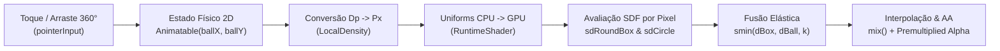

# Bem-vindo à Wiki do Membrana 🫧🔬

A **Wiki do Membrana** é a documentação técnica e matemática oficial do aplicativo **Membrana**, um laboratório interativo para Android construído com **Jetpack Compose** e **AGSL (`RuntimeShader`)** que simula a tensão superficial e deformação elástica em 360° entre corpos geométricos em tempo real na GPU.

---

## 🎯 Sobre o Projeto

Em interfaces tradicionais, elementos gráficos são tratados como polígonos ou caixas rígidas independentes. O **Membrana** explora uma abordagem radicalmente diferente oriunda da computação gráfica procedural e *raymarching*: a representação implícita de formas através de **Signed Distance Fields (SDF)** avaliados por pixel em um fragment shader **AGSL (Android Graphics Shading Language)**.

Quando a esfera invasora se aproxima ou atravessa as fronteiras da pílula central, as duas superfícies não apenas se sobrepõem — elas compartilham um **campo escalar contínuo** governado por um operador de **Smooth Minimum Polinomial (`smin`)**, criando pontes líquidas, pescoços de tensão e mistura cromática orgânica a 60/120 FPS.

---

## 🗺️ Índice da Documentação Técnica

A documentação foi segmentada em quatro pilares de engenharia e matemática aplicada:

1. **[📐 1. Fundamentos Matemáticos: Signed Distance Fields (SDF)](Fundamentos-Matematicos-SDF)**  
   Definição formal de campos de distância com sinal em $\mathbb{R}^2$, propriedade Eikonal ($\|\nabla f\| = 1$) e dedução geométrica passo a passo das funções `sdCircle` e `sdRoundBox`.

2. **[🧪 2. Fusão Líquida e Tensão de Membrana: Smooth Minimum (`smin`)](Fusao-Liquida-Smooth-Minimum)**  
   Por que a união clássica $\min(a, b)$ quebra a continuidade diferencial, a dedução algébrica do *Polynomial Smooth Minimum* quadrático de Inigo Quilez, a física do parâmetro de tensão `uBlendK`, interpolação cromática baricêntrica e anti-aliasing analítico na borda.

3. **[⚡ 3. Pipeline GPU no Android: AGSL & `RuntimeShader`](AGSL-RuntimeShader-Pipeline-GPU)**  
   Arquitetura do AGSL no motor Skia/HWUI do Android 13+ (API 33), diferenças em relação ao GLSL padrão, ciclo de vida de memória do `RuntimeShader`, sincronização de *uniforms* e estratégia de fallback vetorial para Android 7.0–12 (APIs 24–32).

4. **[🎢 4. Interação 360°, Gestos e Física de Mola (`Spring`)](Fisica-de-Mola-e-Gestos-Compose)**  
   Captura multiaxial de ponteiros no Jetpack Compose, modelo matemático do oscilador harmônico subamortecido (`SpringSpec`), paralelismo em corrotinas e invalidação exclusiva da fase de *Draw* sem recomposição de layout.

---

## 🔗 Referências Rápidas no Código

| Arquivo | Responsabilidade Principal |
| :--- | :--- |
| [`ElasticWavesShaderBox.kt`](https://github.com/filipecancio/membrana/blob/main/app/src/main/java/com/cancio/membrana/ui/components/ElasticWavesShaderBox.kt) | Código-fonte do shader AGSL (`ELASTIC_WAVES_AGSL`), gerenciamento do `RuntimeShader`, gestos 2D e física de mola. |
| [`MembranaScreen.kt`](https://github.com/filipecancio/membrana/blob/main/app/src/main/java/com/cancio/membrana/ui/MembranaScreen.kt) | Tela de controle de calibração em tempo real (`uBlendK`, `uBallRadius` e reset de estado). |
| [`MainActivity.kt`](https://github.com/filipecancio/membrana/blob/main/app/src/main/java/com/cancio/membrana/MainActivity.kt) | Configuração `EdgeToEdge` e inicialização da árvore Compose. |
